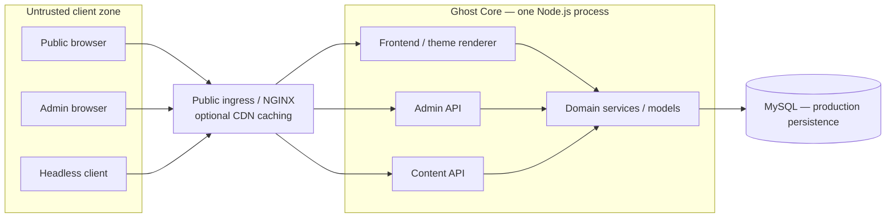
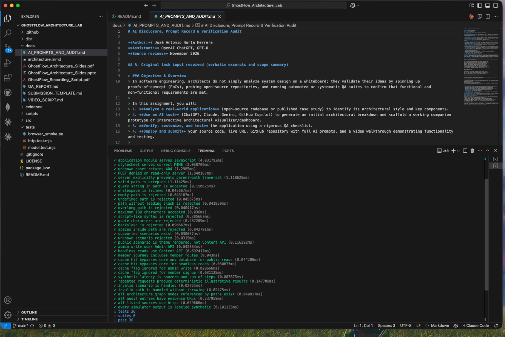

# GhostFlow — Architecture Lab

**An interactive architecture explorer and request-flow simulator for Ghost CMS.**

GhostFlow is a browser-based proof of concept (PoC) that translates a verified analysis of [Ghost](https://github.com/TryGhost/Ghost), the open-source publishing platform, into an interactive system model. It exposes architectural boundaries, compares common request paths, and demonstrates how inaccurate assumptions about a codebase can distort a system-design review.

**Author:** José Antonio Horta Herrera  
**Technology:** JavaScript (ES modules), HTML5, CSS3, Node.js 20+, `node:test`  
**License:** [MIT](LICENSE)

## Overview

GhostFlow is a **standalone educational simulator**, not a Ghost installation, fork, or live API client. It uses a deterministic model instead of a production backend. The application does not access a Ghost instance, persist account information, or claim to measure real service latency.

The prototype provides four connected workspaces:

| Workspace | Capability |
| --- | --- |
| **Architecture overview** | Explore an original, zone-aware component diagram; inspect component responsibilities and trace four common workflows. |
| **Request trace** | Simulate public page rendering, publishing, headless content retrieval, and member signup; inspect each logical processing step. |
| **AI verification** | Review candidate architectural claims alongside corrected interpretations and primary-source references. |
| **QA workspace** | Execute 14 in-browser self-checks and inspect a distinct manual quality-assurance matrix. |

### Scope and limitations

- Request traces and durations are **synthetic and deterministic**, intended only to illustrate dependencies and trade-offs.
- The optional CDN path models a **hypothetical cache hit**; it is not asserted to be part of every Ghost deployment.
- A diagram arrow between modules inside Ghost Core represents a **logical in-process dependency**, not a separate network service.
- The project has no Ghost credentials, external API integrations, third-party npm runtime dependencies, or database connection.

## Case study: Ghost architecture

### Architectural style

Ghost Core is best understood as a **layered, modular Node.js application**, not as a microservice for every API route, user interface, or domain feature. Public routing and theme rendering, management APIs, content APIs, and business logic are distinct responsibilities within the core runtime. Built browser applications form separate client boundaries; their existence does not turn core modules into independently deployed services.

Ghost's documented conventional self-hosting stack uses **Node.js, MySQL, and NGINX**. CDN caching, external media storage, and additional integrations are deployment-dependent. Ghost's Admin UI includes a React application alongside legacy Ember functionality during its evolution; describing the entire Admin experience as exclusively Ember is outdated.

### System context



The complete editable source for the original architecture diagram is [`docs/architecture.mmd`](docs/architecture.mmd). A supplementary [architecture PDF](docs/GhostFlow_Architecture_Slides.pdf) provides the visual design and system boundaries.

### Major components and trade-offs

| Component | Responsibility | Architectural consideration |
| --- | --- | --- |
| Public and Admin browser clients | Trigger HTTP requests and render user interfaces | Client state is not a trusted security boundary. |
| NGINX / ingress | Route incoming requests; commonly terminate TLS | Infrastructure topology and caching behavior depend on deployment. |
| Frontend and theme renderer | Resolve public routes and server-render themes | Can use in-process capabilities; it need not invoke the Content API over HTTP. |
| Admin API | Handle authenticated management operations | Input validation and permissions belong on the server. |
| Content API | Expose published content to remote consumers | Introduces a real HTTP boundary for headless applications. |
| Domain services and models | Coordinate application behavior and persistence | Modularity improves maintainability without independent service deployment. |
| MySQL and media adapters | Store application data and media | Persistence and adapter selection constrain scaling and operational complexity. |
| External effects | Deliver mail, webhooks, and integrations where configured | Optional dependencies add distinct failure and retry considerations. |

### Modeled request paths

```text
Public page    Browser  → Ingress → Theme renderer → Services → MySQL
Admin publish  Admin UI → Ingress → Admin API      → Services → MySQL → Effects
Headless read  Client   → Ingress → Content API    → Services → MySQL
Member signup  Browser  → Ingress → Member routes  → Services → MySQL → Effects
```

These flows are **simplified logical models**, not exhaustive traces of all internal calls. The member signup route and outbound integrations are illustrative and may vary with Ghost version and configuration. A simulated public/headless cache hit may terminate at the optional edge-cache node; a management write cannot use that read-cache shortcut.

### Primary sources

The architectural assertions were compared with first-party Ghost documentation and repository materials (reviewed November 2026):

1. [Ghost runtime architecture](https://github.com/TryGhost/Ghost/blob/main/docs/codebase/runtime-architecture.md)
2. [Ghost monorepo structure](https://github.com/TryGhost/Ghost/blob/main/docs/codebase/monorepo-structure.md)
3. [React Admin README](https://github.com/TryGhost/Ghost/blob/main/apps/admin/README.md)
4. [Official Ghost hosting documentation](https://docs.ghost.org/hosting/)

## Engineering implementation

### Design decisions

- **Dependency-free runtime:** native browser JavaScript and Node's built-in HTTP server make local verification straightforward.
- **Explicit architecture model:** `src/model.mjs` defines immutable component metadata, request scenarios, and validation rules independently of UI rendering.
- **Deterministic simulation:** every scenario produces repeatable steps and illustrative timing values, making regression testing reliable without a production service.
- **Defensive input handling:** unsupported path characters, empty values, and overly long paths are rejected before trace generation; dynamic text is rendered through DOM text APIs.
- **Accessible, responsive interface:** semantic controls, keyboard focus styling, and flexible layouts support multiple screen sizes.
- **Separation of evidence:** automated model/HTTP checks, in-browser self-checks, and human-observed browser compatibility are reported as distinct verification categories.

### Repository structure

```text
.
├── .github/workflows/deploy.yml   # Static build, tests, and Pages publishing
├── docs/
│   ├── AI_PROMPTS_AND_AUDIT.md    # AI usage, prompt record, and source audit
│   ├── QA_REPORT.md               # QA scope, results, and manual verification
│   ├── architecture.mmd           # Original architecture diagram
│   └── GhostFlow_Architecture_Slides.pdf
├── evidence/
│   ├── README.md                  # Evidence register
│   └── 01-automated-tests.png     # Observed terminal test result
├── scripts/
│   ├── build.mjs                  # Static output generation
│   └── serve.mjs                  # Local HTTP server
├── src/
│   ├── index.html
│   ├── styles.css
│   ├── app.mjs                   # UI controller
│   └── model.mjs                 # Domain model and simulation
├── tests/
│   ├── model.test.mjs
│   ├── http.test.mjs
│   └── browser_smoke.py
├── package.json
└── README.md
```

### Prerequisites and local execution

- Node.js **20+**
- A modern desktop browser
- No `.env`, credentials, API keys, or `npm install` step is required

```bash
npm run dev
```

Open [`http://localhost:4173`](http://localhost:4173) in the browser. The server supports a custom port through the `PORT` environment variable.

### Build and test

```bash
npm run check        # JavaScript syntax checks
npm test             # Unit and HTTP tests
npm run build        # Static output in dist/
SERVE_DIST=1 npm run dev  # Serve the production build locally
```

The project includes a GitHub Actions workflow that runs syntax checks, tests, and the static build before publishing to GitHub Pages when that hosting environment is configured. Generated `dist/` assets are intentionally excluded from version control.

## Quality assurance

### Automated verification

| Verification area | Method | Recorded result |
| --- | --- | --- |
| JavaScript syntax | `npm run check` | Passed |
| Architecture model and validation | `node:test` | 30 / 30 passed |
| Local HTTP behavior | `node:test` | 6 / 6 passed |
| Static output generation | `npm run build` | Passed |
| **Total automated tests** | **`npm test`** | **36 / 36 passed** |



The in-browser QA workspace provides **14 additional self-checks** that are not part of the 36 Node tests. Manual checks for desktop/mobile layout, cross-browser behavior, browser Console/Network health, keyboard access, and perceived performance remain **unverified until observed**. See the [QA report](docs/QA_REPORT.md) for scope and status, and the [evidence register](evidence/README.md) for available captures.

## AI-assisted development and verification

**AI tool:** OpenAI ChatGPT (GPT-6). AI assisted with architectural research, project scaffolding, UI implementation, simulation logic, documentation, and test design. The exact original task context and reproducible implementation specification are distinguished in the [AI prompt and audit record](docs/AI_PROMPTS_AND_AUDIT.md); AI-generated hypotheses are not misrepresented as actual user messages.

| Candidate AI assumption | Verified finding / refinement |
| --- | --- |
| Ghost Admin is entirely Ember. | React Admin exists alongside legacy Ember functionality. |
| Each Ghost API or theme is an independently deployed microservice. | Core frontend, APIs, and shared services are modules in the primary Node.js process. |
| Theme rendering always makes a Content API HTTP request. | Server-rendered themes can use in-process services; headless clients use the Content API over HTTP. |
| Redis, Kubernetes, and sharded MySQL are required for all deployments. | Conventional hosting documentation does not establish those as universal requirements. |

These assumptions were **evaluated and corrected during the audit**, not necessarily emitted verbatim as errors by an earlier model response. The implemented simulator uses corrected boundaries, labels its synthetic data, validates input, and distinguishes observed test results from unverified behavior.

## Attribution and license

Ghost is an open-source publishing platform developed by the Ghost Foundation. GhostFlow is an independent educational architecture PoC, **not affiliated with or endorsed by Ghost**. The project and its diagrams are original; architectural references are attributed above. This repository is released under the [MIT License](LICENSE).
